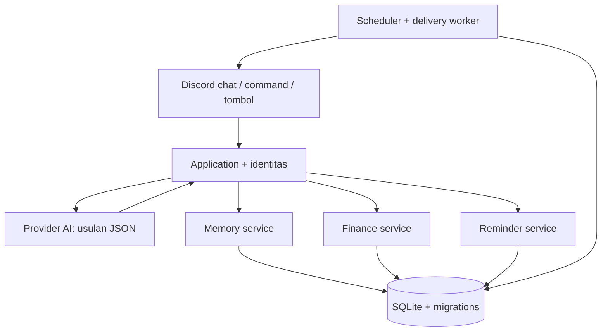
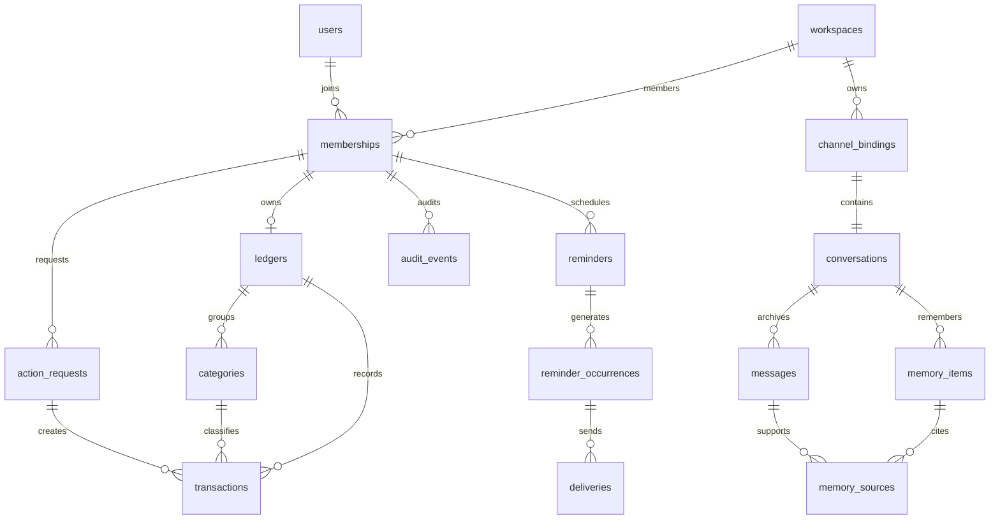
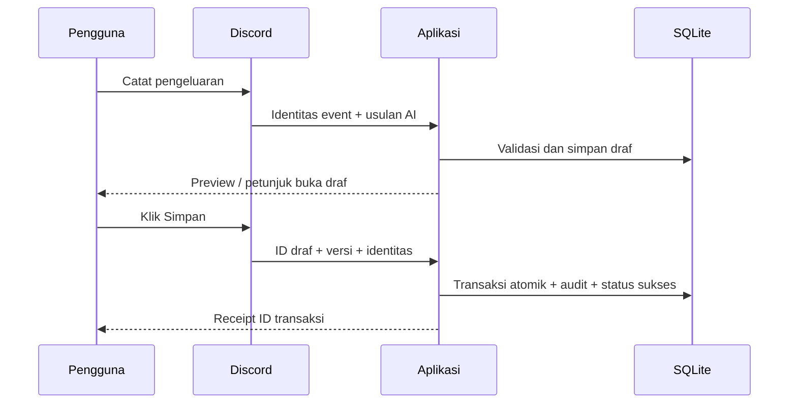

# Elaine v2.1

Asisten Discord berbahasa Indonesia: teman percakapan dengan personality tetap, arsip percakapan, pengingat/alarm teks, dan pencatatan keuangan pribadi. Instalasi baru: **DEPLOY.md**. Upgrade dari 2.0: **UPGRADE.md**. Perubahan: **CHANGELOG.md**.

## Fitur yang tersedia

- **Elaine ekspresif secara default.** Nada tenang, hangat, humor kering, bisa menegur saat konteksnya cocok dan menggunakan gestur singkat. Tidak ada command pengaturan gaya. Gestur merupakan ekspresi teks/roleplay, bukan tindakan fisik. Persona ada di `prompts/elaine.md`.
- **Ingatan per channel.** Arsip SQLite persisten, maksimal 40 pesan terbaru serta hingga 12 kecocokan kata dari arsip lama, fakta yang diminta pengguna, dan ringkasan berkala dengan tautan sumber internal. Konteks dibatasi karakter; bot tidak mengingat semua arsip sekaligus. Edit/hapus pesan yang teramati menonaktifkan ingatan turunannya. Riwayat awal yang diambil saat startup dibatasi `HISTORY_SYNC_LIMIT`.
- **Pengingat.** Sekali, harian, mingguan; timezone profil, tombol diterima/selesai/tunda 10 menit, ubah/batal seri, serta daftar pribadi. Alarm bisa disertai suara di voice channel pilihan (30 detik per kiriman, pemilik hadir). Alarm mengirim maksimal 3 notifikasi berjarak 5 menit secara default, berhenti jika diakui. Pengingat tetap tersimpan setelah restart.
- **Keuangan IDR pribadi.** Pemasukan/pengeluaran, kategori, tanggal, catatan, rekap harian/bulanan, pagination, CSV, koreksi, pembatalan, dan penghapusan dari riwayat dengan audit. Nominal integer, total dihitung SQL. Arus bersih bukan saldo rekening bank.
- **Percakapan alami dan slash command.** Chat mengusulkan tindakan terstruktur; service memvalidasi identitas/argumen. Chat keuangan membuat draf dulu. Form `/uang tambah` menyimpan saat pengguna Submit. Command terstruktur tidak bergantung pada AI.

## Contoh penggunaan

```text
Elaine, aku susah fokus hari ini.
Ingat bahwa aku biasanya belajar malam.
Ingatkan besok jam 20:00 untuk belajar Python.
Buat alarm setiap hari jam 07:00 mulai besok untuk bangun pagi.
Catat pengeluaran 25 ribu untuk makan hari ini.
```

Tanggal/jam yang belum jelas akan ditanyakan kembali. Penerjemahan bahasa alami tetap bisa salah: periksa receipt pengingat dan draf transaksi. Untuk jadwal/nominal pasti gunakan command atau formulir.

| Kelompok | Command |
|---|---|
| Elaine | `/elaine bantuan`, `/elaine profil`, `/elaine preferensi`, `/elaine ingatan`, `/elaine lupakan` |
| Pengingat | `/ingat buat`, `/ingat daftar`, `/ingat detail`, `/ingat ubah`, `/ingat batal` |
| Keuangan | `/uang tambah`, `/uang draf`, `/uang ringkasan`, `/uang riwayat`, `/uang detail`, `/uang ubah`, `/uang batal`, `/uang hapus`, `/uang ekspor` |
| Admin | `/admin channel`, `/admin status`, `/admin ai`, `/admin ai_tes` |
| Suara | `/suara gabung`, `/suara tes`, `/suara keluar` |
| Menu pesan | Klik kanan pesan → Apps → Buat pengingat |

Periode keuangan `2026-10` untuk bulanan atau `2026-10-28` untuk harian. Jenis transaksi `income`/`expense`; jadwal `reminder`/`alarm`; pengulangan `none`/`daily`/`weekly`. Hari mingguan 0=Senin sampai 6=Minggu. ID singkat dari daftar bisa dipakai untuk detail/ubah/batal. Timezone profil mengatur jadwal baru; jadwal lama mempertahankan timezone saat dibuat. Ledger mempertahankan timezone ketika pertama dibuat.

## Channel Discord

Channel utama `CHANNEL_ID` aktif otomatis, default membalas semua pesan manusia yang memenuhi cooldown. Gunakan `CHAT_MODE=mention_only` saat pendaftaran pertama jika ingin balasan hanya mention/reply. Sesudah channel tersimpan, perubahan mode lewat `/admin channel`.

Admin dapat mendaftarkan channel lain untuk chat, pengingat, keuangan, atau admin. Respons keuangan slash command bersifat ephemeral. Chat di channel bersama tetap terlihat oleh anggota channel: jangan mengetik data finansial sensitif di sana. Di channel bersama hasil keuangan diarahkan ke `/uang draf` atau `/uang ringkasan`.

Untuk chat keuangan privat, buat channel privat di Discord, batasi semua role yang dapat melihatnya, lalu `/admin channel` fungsi finance dengan pemilik. Bot menolak akses aplikasi dari pemilik lain; admin Discord yang punya izin tetap mungkin membaca pesan channel. Pemeriksaan otomatis penolakan `@everyone` tidak menjamin seluruh role lain sudah benar. Balasan AI dalam channel bisa dibaca semua orang yang punya akses channel tersebut. Arsip channel dikirim ke provider AI sebagai konteks.

## Arsitektur



| Modul | Tanggung jawab |
|---|---|
| `discord_adapter.py`, `commands.py`, `views.py` | Event Discord, command, modal, tombol, izin channel |
| `application.py` | Routing usulan AI ke domain dan receipt hasil |
| `provider.py`, `schemas.py`, `runtime_config.py`, `prompts/elaine.md` | Adapter API kompatibel, validasi payload, personality tetap |
| `identity.py` | Workspace, pengguna, keanggotaan, timezone, binding channel |
| `presentation.py`, `voice.py`, `reactions.py` | Kartu embed, alarm suara, dan pemisahan reaksi dari teks |
| `memory.py` | Arsip, pengambilan konteks, fakta, ringkasan dan sumber |
| `finance.py`, `actions.py` | Ledger, draf, idempotensi, rekap, audit |
| `reminders.py` | Jadwal, occurrence, ack/snooze, outbox, retry |
| `db.py`, `migrations/` | Schema, transaksi database, evolusi versi |
| `cli.py`, `bootstrap.py` | Perakitan dependency, migrate/check/backup/import |

## ERD inti



## Alur penyimpanan



Scheduler menyimpan occurrence dan outbox terlebih dahulu. Worker mengklaim delivery, memeriksa izin dan versi, mengirim ke Discord, kemudian mencatat hasil. Retry memakai backoff dan maksimal 5 percobaan untuk kegagalan pengiriman terdeteksi. Pengingat satu kali yang terlambat lebih dari 24 jam ditandai missed. Seri berulang mengejar jadwal terakhir, tidak membanjiri seluruh backlog.

## Batasan yang perlu dipahami

- Alarm berupa notifikasi Discord dan suara opsional di voice channel, bukan alarm perangkat di luar Discord. Pengiriman membutuhkan VPS dan koneksi Discord aktif; notifikasi perangkat bergantung pada pengaturan Discord.
- Pengiriman eksternal tidak menjamin exactly-once: crash setelah Discord menerima pesan tetapi sebelum receipt database tersimpan dapat menghasilkan duplikat. Pembatalan yang berbarengan dengan request kirim yang sudah berjalan juga mungkin terlambat untuk menarik pesan itu.
- Satu proses aktif per database. SQLite cocok untuk beban awal; bukan arsitektur multi-instance. Arsip tumbuh dan perlu dipantau/back up. Belum ada pruning otomatis, vector database, atau full-text index; pencarian arsip memakai kecocokan kata.
- Hapus/edit yang terjadi ketika bot offline di luar jangkauan sinkronisasi startup mungkin belum direkonsiliasi. `/elaine lupakan` menghapus fakta khusus, bukan semua pesan sumber dari arsip atau Discord.
- Ringkasan AI membantu konteks, bukan bukti tunggal yang sempurna. Laporan keuangan selalu berasal dari transaksi terstruktur, bukan ringkasan percakapan.
- Panel pagination berakhir setelah 5 menit; buka command lagi. Tombol reminder memakai custom ID persisten; panel ephemeral masih mengikuti masa hidup pesan Discord.
- Belum ada shared ledger, transfer bank, kurs otomatis, quiet hours, web browsing, atau general-purpose shell tools. Alarm tidak mendeteksi apakah pengguna sudah bangun; klik tombol untuk menghentikannya.
- Provider harus mendukung endpoint kompatibel `/chat/completions`. Native API Anthropic perlu adapter tambahan. Model Sonnet berjalan di penyedia API, bukan lokal VPS.

## Mengembangkan fitur

Tambahkan service domain baru, schema input, adapter command, dan test. Jika butuh natural language, tambah jenis `Proposal` dan routing di application. Semua mutasi tetap memeriksa owner, source key idempotent, dan versi bila relevan. Tambah migration baru saat schema berubah; jangan edit `0001_initial.py`. Hindari memanggil jaringan dari dalam transaksi SQLite. Pemisahan ini memungkinkan mengganti provider atau storage tanpa merombak personality dan UI seluruhnya.

```bash
python3 -m venv .venv
.venv/bin/pip install -r requirements.lock
.venv/bin/pip install -e '.[dev]'
.venv/bin/pytest -q
.venv/bin/ruff check src tests
```

Lihat `TESTING.md` untuk hasil verifikasi dan pemeriksaan live yang masih diperlukan.

## Konfigurasi dan tampilan 2.1

Profil Elaine kini terpisah dari preferensi pengguna. UI menggunakan kartu embed native Discord, lima item per halaman, warna status dan tombol. Hapus transaksi memerlukan konfirmasi dan mempertahankan audit internal. Model/endpoint/key/context dapat diubah melalui /admin ai oleh pemilik aplikasi, tersimpan terenkripsi dan bertahan setelah restart. Lihat UPGRADE.md untuk izin, backup key, batas context dan uji voice.
